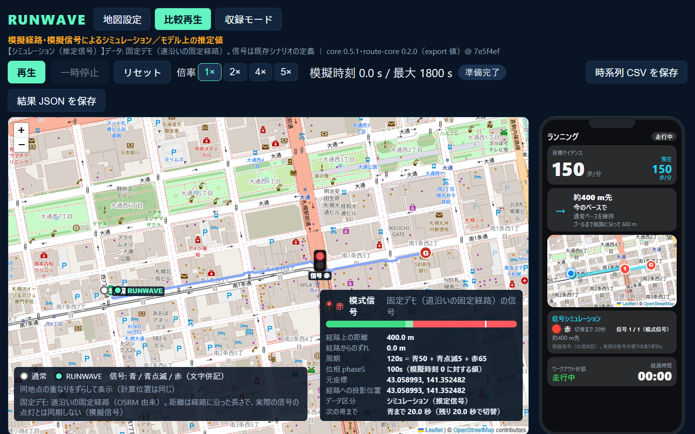
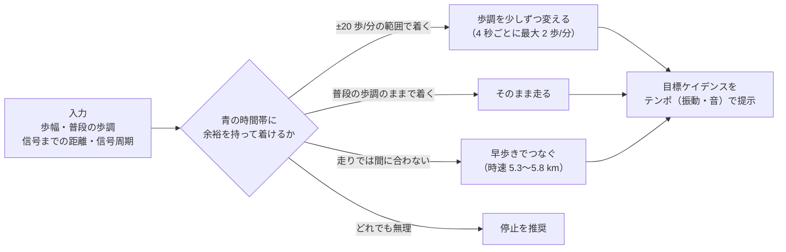
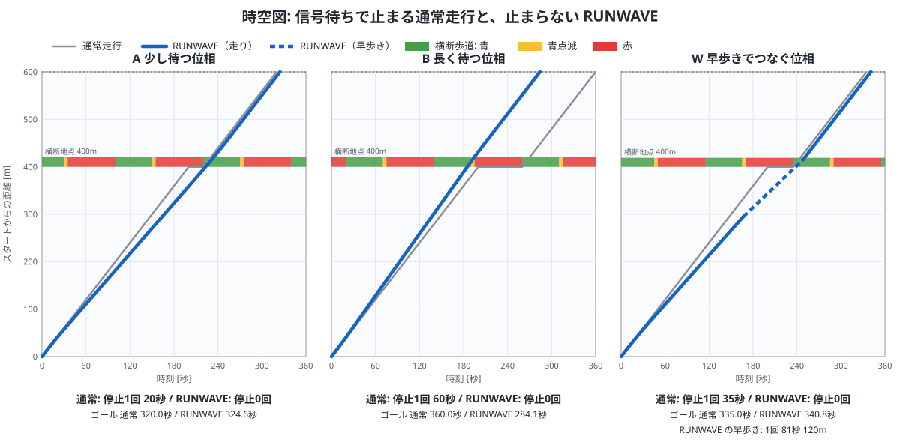
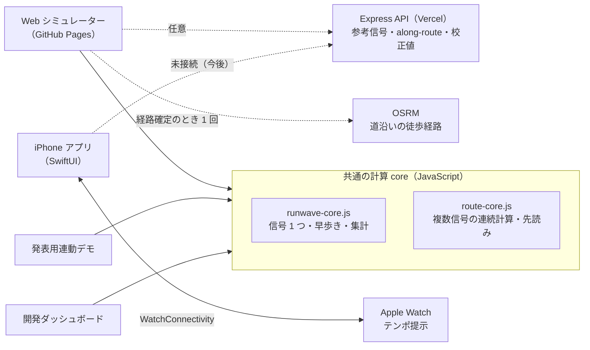

# RUNWAVE

**信号待ちで途切れるランニングのリズムを、少しの歩調調整でつなぐ。**

信号の手前から歩調（ケイデンス）を少しずつ変えて、**止まらずに青の時間帯に着く**ことを目指すランニング支援プロトタイプです。

<p align="center">
  <a href="https://jphacks.github.io/sp_2601/web-simulator/"></a>
</p>

<p align="center">
  <a href="https://jphacks.github.io/sp_2601/web-simulator/"><b>▶ Web シミュレーターを開く</b></a>（開発中のデモ・インストール不要）
  ・ <a href="https://jphacks.github.io/sp_2601/dev-dashboard/">開発ダッシュボード</a>
  ・ <a href="#3-分で試す">3 分で試す手順</a>
</p>

> [!NOTE]
> 実際のアプリ（iPhone / Apple Watch）は **Apple Maps（MapKit）** を使います。ブラウザで動く地図（OpenStreetMap・Leaflet）は、仕組みを確かめるための**シミュレーション**です。画面写真もブラウザのシミュレーションで、実際のアプリの画面ではありません。

> [!WARNING]
> RUNWAVE の出力は実際の信号と同期していません。横断の判断には使えません。実際の道路では交通ルール、信号表示、周囲の状況に従ってください。出力を根拠に横断したり、信号に間に合わせるために速度を上げたりしないでください。

## 30 秒でわかる RUNWAVE

| | |
| --- | --- |
| **困りごと** | 街中を走っていると、リズムに乗ってきたところで信号待ちになり、止まってから走り出し直す。信号の直前で急ぐのも落ち着かない |
| **アイデア** | 信号の**手前から**、普段の歩調の ±20 歩/分の範囲で少しずつテンポを変え、青の時間帯に着くようにする。走りで間に合わない場面だけ早歩きでつなぐ |
| **モデル上の結果** | 札幌中心部の **5 交差点・約 1.8 km**（固定デモ D）で、通常走行は **3 回・計 131 秒** 止まるのに対し、RUNWAVE は **停止 0 回**。所要時間の差は **+6 秒** |
| **いま動くもの** | Web シミュレーター（地図で比べる開発中のデモ・公開中）、共通の計算 core、バックエンド API（公開中）、発表用連動デモ、iPhone / Apple Watch アプリのソース |
| **まだのもの** | 実機アプリと信号計算の接続、実走での検証（[現在の実装範囲](#現在の実装範囲)） |

結果はすべて、模擬信号・推定信号に対するモデル上の計算です（[数値で見る効果](#数値で見る効果モデル上の比較例)）。

## 3 分で試す

ブラウザだけで試せます。サーバーの起動やログインはいりません。Web シミュレーターの地図機能は**開発中の未完成なデモ**で、操作や表示に整っていない部分があります。また、実際のアプリは Apple Maps（MapKit）を使うため、ブラウザの地図はあくまでシミュレーションである点に注意してください。

1. **[Web シミュレーター](https://jphacks.github.io/sp_2601/web-simulator/)を開き、「再生」を押す。** 固定デモ B（信号 1 つ）で、左の通常走行は赤で 60 秒止まります。RUNWAVE は手前から歩調を少し上げて、止まらずに通過します。倍率を「5×」にすると約 1 分で終わります。
2. **「地図設定」→「固定デモ」で D を選ぶ。** 5 つの交差点を続けて通ります。右の iPhone 画面パネルで、目標ケイデンス・信号までの距離・案内文が地図と同じ時刻で動きます。
3. **「地図でコース作成」で自分のコースを作る。** 開始・終了・経由点を置いて「経路確定」を押すと、OpenStreetMap の道沿いの経路に置き換わり、近くの模擬信号（2〜5 件）を通るコースで比べられます。
4. **「結果 JSON を保存」「時系列 CSV を保存」** で、条件と 0.1 秒ごとの経過を持ち帰れます。

## 製品概要

### 背景（製品開発のきっかけ、課題等）

街中を走っていると、自分に合ったリズムができたところで信号待ちになり、止まってから再び走り出す場面があります。札幌中心部のような碁盤の目の街では、数百 m ごとに信号があります。

信号の直前で急いだり立ち止まったりする代わりに、手前から少しずつ歩調を変えられたら、流れを保ったまま青の時間帯に到着できるかもしれない。RUNWAVE はこの考えを、同じ条件での通常走行との比較で確かめるプロジェクトです。

**想定ユーザー**: 街中の決まったコースを、普段の歩調で気持ちよく走りたい市民ランナー。タイムを縮めることより、止まらずに続けて走れる感覚を大事にする人です。

### 製品説明（具体的な製品の説明）

歩幅・普段のケイデンス・交差点までの距離・信号周期から、**青の時間帯に到着するための目標ケイデンス**を 1 秒ごとに計算します。ここでの BPM は **歩/分（1 拍 = 1 歩）** で、心拍数とは別の値です。



下の図は、信号 1 つのコースで通常走行（灰）と RUNWAVE（青）の動きを比べた **時空図** です。横軸が時刻、縦軸がスタートからの距離で、信号の位置に赤・青の時間帯を描いています。通常走行は赤で止まるので線が水平になります。RUNWAVE は手前で傾き（速さ）を少し変え、青の時間帯を通り抜けます。

<p align="center">
  
</p>

図は `npm run figures` で core の計算結果から生成しています（[tools/readme-figures.js](tools/readme-figures.js)）。

RUNWAVE は次の 3 つの形で見られます。

- **Web シミュレーター**（開発中の未完成なデモ、[README](frontend/web-simulator/README.md)）: 実際のアプリが使う Apple Maps ではなく、OpenStreetMap の地図を使ったシミュレーションです。地図上で通常走行と RUNWAVE を並べて再生します。固定デモは、信号 1 つの A/B/W と 5 交差点の D があり、どれも道沿いの固定経路です。任意コースでは「経路確定」で OpenStreetMap の道沿いの徒歩経路（OSRM）に置き換え、2〜5 件の信号を続けて通れます。地図の横には iPhone アプリの走行中画面を再現したパネルがあり、地図と同じ時刻の計算結果で動きます。再生は 1 / 2 / 4 / 5 倍速で、倍率を変えても同じ模擬時刻の結果は一致します。
- **発表用連動デモ**（[README](frontend/presentation-simulator/README.md)）: 人物・入力・判定・スマホ／Watch の画面イメージを 1 画面にまとめ、仕組みを順に見せます。
- **iPhone / Apple Watch アプリ**（ソース）: 歩幅・自然なケイデンスの校正、位置・歩数による走行計測、結果表示、端末間通信、振動・音によるテンポ提示のソースがあります。Web / core の信号計算から実機の案内までをつなぐ連携は未完成で、実機での動作確認の記録もありません。

### 特長

#### 1. 普段の歩調に近い、小さな調整

通常ケイデンスの ±20 歩/分の範囲で目標を 1 秒ごとに見直し、実際の歩調は 4 秒ごとに最大 2 歩/分ずつ変えます。青に着ける候補のうち、**普段の歩調との差が小さいもの**を優先し、同じ差なら減速側を選びます。

このため、停止がなくなる代わりに総所要時間が少し長くなることがあります。RUNWAVE は所要時間だけでなく「どれだけ止まらずにつながったか」を見ます。選択規則は [core 契約](core/CONTRACT.md) と [計算実装](core/runwave-core.js) にまとめています。

#### 2. 青の時間帯に、余裕を持って着く

青になった直後と青が終わる直前を避けた到着時間帯を狙います。core の既定は「開始後 3 秒・終了前 8 秒」です（固定デモ A/B/W は終了前 5 秒を明示）。青点滅・赤での進入はさせず、調整で通過できないときは停止を推奨します。推定値の信号では加速を案内しません（要件 v2 SAFE-03）。

#### 3. 必要な場面だけ、早歩きでつなぐ

走りの調整では余裕を持って青に着けず、普段の歩調でも通れないときだけ、時速 5.3〜5.8 km の早歩きを候補にします。横断に必要な時間も計算し、渡り終えるまで歩きます。詳細は [早歩きフェーズの契約](core/CONTRACT.md) にあります。

#### 4. 複数の信号を、続けて計算する

[route-core](core/route-core.js) は、時刻・位置・歩調・集計をリセットせずに複数の信号を続けて計算し、次の信号を先読みします。経路全体を一度に最適化するのではなく、いま向かっている信号に合わせて判断します（[複数信号の契約](core/CONTRACT-route.md)）。

### 既存のアプローチとの違い

信号による中断への対策には、いくつかの方向があります。RUNWAVE は **「コースはそのまま、走る側が信号に合わせて歩調を少しずつ変える」** 方式です。

| アプローチ | 例 | 対象 | RUNWAVE との違い |
| --- | --- | --- | --- |
| 信号の少ないルートを選ぶ | Run Supporter by NAVITIME（ルート検索で「信号が少ない」を選べる）[^runsupporter] | ランナー | 走る前に信号を避けるコースを選ぶ方式。RUNWAVE は選んだコースの途中で、信号ごとに歩調を合わせる。両者は併用できる |
| 一定のテンポを保つ | Garmin のメトロノーム機能（設定した BPM で音・振動）[^garmin] | ランナー | 目標テンポは固定。RUNWAVE は信号の青の時間帯に合わせて目標を動かし、必要な場面だけ普段の歩調から外れる |
| 信号情報で速度を案内する（GLOSA） | Audi Traffic Light Information[^audi]、Signal2X[^signal2x] | 車・自転車 | 速度の目安を出す方式。RUNWAVE はランナーの歩調（歩/分）を単位に、普段の歩調との差が小さい候補を選び、早歩きも候補に入れる |
| 歩行者に信号情報を届ける・青を延ばす | 信GO！（高度化 PICS 対応交差点で灯色の通知・青延長の要求）[^singo]、Crosswalk（オランダでの青時間延長の試験）[^crosswalk] | 歩行者（視覚障害者・高齢者など） | 対応する交差点と信号側の仕組みが必要。RUNWAVE は信号に手を加えず、手前からの歩調で到着時刻を合わせる |

ランナー向けに、信号のタイミングへ歩調を合わせる既存サービスは、今回の調べた範囲（2026-10-18、Web 検索）では見つかりませんでした。論文データベースまでの網羅的な確認はしていません。

[^runsupporter]: Impress Watch「NAVITIME、ランニングアプリ『Run Supporter』」<https://www.watch.impress.co.jp/docs/news/2116896.html>
[^garmin]: Garmin Forerunner 945 マニュアル「Metronome」<https://www8.garmin.com/manuals/webhelp/forerunner945/EN-US/GUID-7C3A8FE0-035D-43D2-8E5E-6B0FC75DD00C.html>
[^audi]: TechCrunch「Audi's new V2I feature helps drivers hit every green light」(2019) <https://techcrunch.com/2019/02/19/audis-new-v2i-feature-helps-drivers-hit-every-green-light/>
[^signal2x]: App Store「Signal2X」<https://apps.apple.com/app/id1584985205>
[^singo]: 福岡県警察「高度化 PICS」<https://www.police.pref.fukuoka.jp/data/open/cnt/3/46/1/koudokaPICS.pdf>、日本信号「信GO！取扱説明書」<https://www.signal.co.jp/images/products/traffic/sinGO-iOS-manual.pdf>
[^crosswalk]: IamExpat「Tilburg launches app trial to help elderly cross the road」<https://www.iamexpat.nl/expat-info/dutch-expat-news/tilburg-launches-app-trial-help-elderly-cross-road>

### 解決できること

- 信号に合わせた歩調調整で、停止によるリズムの中断を減らせる条件を調べられる。
- 同じコース・信号条件で通常走行と比べ、停止時間・歩調の変化・所要時間の関係を確かめられる。
- 走りの調整だけでは難しい場面で、早歩きを挟む選択を検証できる。

効果は信号周期・初期位相・距離・歩幅で変わります。ここでの結果はモデル条件の中の結果で、実際の街中での停止回避率を示すものではありません。

### 数値で見る効果（モデル上の比較例）

「リズムが途切れない」ことを、core は次の指標で集計します（[core 契約](core/CONTRACT.md)）。

- **止まらずに続いた最長時間**（`longestRunS`）: 信号待ちで止まらずに移動し続けられた最長の時間。
- **普段の歩調から外れた時間・ずれの量**（`offBaseTimeS`・`deviationBpmS`）: 調整の負担の目安。
- **歩調の範囲・変更量の累計**（`minBpm`〜`maxBpm`・`totalBpmChange`）: どれだけ歩調を変えたか。

#### 信号 1 つ（`npm run scenarios`、core v0.5.1）

直線 600 m のコースの 400 m 地点に信号 1 つ（周期 120 秒・青 50 秒）、歩幅 0.8 m、通常ケイデンス 150 歩/分で、信号の位相だけを変えています。

| シナリオ | 走り方 | 停止 | 停止時間 | 総所要時間 | 止まらずに続いた最長時間 | 歩調の範囲（歩/分） |
| --- | --- | --- | --- | --- | --- | --- |
| A（少し待つ位相） | 通常走行 | 1 回 | 20 秒 | 320.0 秒 | 200.0 秒 | 150 |
| | **RUNWAVE** | **0 回** | 0 秒 | 324.6 秒 | **324.6 秒（ゴールまで）** | 133〜150 |
| B（長く待つ位相） | 通常走行 | 1 回 | 60 秒 | 360.0 秒 | 200.0 秒 | 150 |
| | **RUNWAVE** | **0 回** | 0 秒 | **284.1 秒** | **284.1 秒（ゴールまで）** | 150〜164 |
| W（早歩きでつなぐ位相） | 通常走行 | 1 回 | 35 秒 | 335.0 秒 | 200.0 秒 | 150 |
| | **RUNWAVE** | **0 回** | 0 秒 | 340.8 秒 | **340.8 秒（ゴールまで、早歩き 81 秒を含む）** | 130〜150 |

A と W では総所要時間が数秒長くなる代わりに、ゴールまで止まらずにつながります。B では 60 秒の停止がなくなり、所要時間も短くなります。

#### 5 交差点を続けて通る（Web の固定デモ D、core v0.5.1・route-core v0.2.0）

札幌中心部の模擬信号 5 つを通る道沿いの経路（約 1.85 km）です。信号の位相は仮の値です。

| 走り方 | 停止 | 停止時間 | 総所要時間 | 止まらずに続いた最長時間 | 歩調の範囲（歩/分） | 早歩き |
| --- | --- | --- | --- | --- | --- | --- |
| 通常走行 | 3 回 | 130.7 秒 | 1055.0 秒 | 435.9 秒 | 150 | なし |
| **RUNWAVE** | **0 回** | 0 秒 | 1060.8 秒 | **1060.8 秒（ゴールまで）** | 130〜150 | 2 回・計 394 秒 |

通常走行は 3 つの交差点で止まり、続けて走れたのは最長 7 分強でした。RUNWAVE は所要時間 +6 秒でゴールまで止まらずにつながります。その代わり、全体の約 4 割を早歩きで進んでいます。早歩きへの切り替えが負担にならないかは、実走で確かめる必要があります。

Web シミュレーターの画面には停止回数・停止時間・所要時間・早歩きの状況を表示し、上の指標は結果 JSON（core の集計）に含まれます。

### 今後の展望・優先して検証すること

モデル上の結果を実際の走行体験につなげるため、次の順に進めます。いずれも今後の項目で、効果を実証済みという意味ではありません。

1. **実機での簡易デモモード**: Web シミュレーターで作ったコースと信号条件を iPhone / Apple Watch に送り、目標ケイデンスの表示と振動・音のテンポ提示を走りながら体験できるようにします。テンポ提示（[TempoOutputPlayer.swift](frontend/watch-app/Runwave%20watch%20Watch%20App/TempoOutputPlayer.swift)）と案内の中継 API（`PUT/GET /api/sessions/:sessionId/guidance`）は実装済みで、その間をつなぐ部分が残っています。
2. **「途切れなさ」をその場で見せる**: core が集計している「止まらずに続いた最長時間」「普段の歩調からのずれ」を、Web の結果画面と実機の走行中画面に出します。通常走行と RUNWAVE の歩調の変化もグラフで比べられるようにします。
3. **信号情報がなくても使える「リズム維持」**: 歩幅・自然なケイデンスの校正とテンポ提示の既存実装を出発点に、位置と歩数から現在のケイデンスを推定し、目標とのずれをリアルタイムで返します。信号情報が不安定な地域や信号のないコースでも使えるようにし、信号に合わせた調整と区別できる体験にします。実測値を core に取り込む [拡張契約](core/CONTRACT-ext.md) は設計案です。
4. **実走でのリズムと快適さの検証**: 同じコースで通常走行と比べ、上の指標に加えて、テンポ調整や早歩きへの切り替えが負担にならないか、リズムが続く感覚や心理的な快適さがあるかを、実測と主観評価の両方で確かめます。
5. **歩行者信号データの精度と取得範囲**: 車両用データ由来の参考プリセットから、実際の歩行者信号を扱う段階へ進むため、取得方法・点灯時刻との同期・予測誤差・地域ごとの利用可能範囲を確認します。Web では信号情報が推定・実測・欠損のときの結果の違いを切り替えて比べられるようにします。
6. **他の移動への応用**: 「普段のペースを基準に、信号の青の時間帯へ合わせる」考え方を、ウォーキングや自転車にも使えるか検討します。

### 注力したこと（こだわり等）

- **普段のリズムを基準にすること**: 速度を上げ続けるのではなく、普段の歩調との差が小さい候補を選びます。
- **同じ条件で比べられること**: 通常走行と RUNWAVE の違いを制御の ON/OFF だけにそろえ、0.1 秒刻みの共通の時計で進めます。倍率を変えても結果が変わらないことを試験で確かめています（[証跡](docs/acceptance/README.md)）。
- **計算を一か所に集めること**: Web・発表用デモ・開発ダッシュボードはすべて同じ core を使い、画面側で信号の判断を作り直しません。
- **デモ値と実測値を区別すること**: 模擬経路・推定信号・未受信データを画面に明示し、信号は色に加えて文字でも表示します。
- **公開しても安全な API にすること**: 公開中の API は書き込みを禁止し、入力値の検査・回数制限・書き込みトークンを入れています。

## 開発技術

### 全体の構成



### 活用した技術

#### API・データ

- **自作の Express API**（[実装](backend/index.js)・[説明](backend/README.md)）: 参考信号、経路に沿った信号の照合（along-route）、キャリブレーション、走行ログ、セッション案内の中継を提供します。公開中: <https://sp-2601.vercel.app>
- **JARTIC 由来の車両用信号データを加工した参考プリセット**: 歩行者信号の実際の点灯情報ではなく、全件に `isEstimated: true` を付けています。推定値の信号では RUNWAVE は加速しないため、API の信号で走らせると固定デモより止まる回数が増えることがあります。
- **[模擬信号 fixture](frontend/web-simulator/src/fixtures.js)**: API なしでもコース作成と固定デモ D が動くように同梱しています。
- **OpenStreetMap の地図タイルと Leaflet**: 経路と信号の表示に使います。
- **[OSRM](https://routing.openstreetmap.de/about.html)**（FOSSGIS 運営の公開サーバー、foot プロファイル）: 任意コースの「経路確定」で 1 回だけ道沿いの徒歩経路を取得します。取得できないときは置いた点を結ぶ直線に戻ります。固定デモの経路は 2026-10-18 に 1 回取得して固定したもので、再生中は通信しません。利用条件（最大 1 リクエスト/秒、大量利用の禁止、帰属表示）に従い、地図に帰属を表示します。OSM のデータに基づく推定経路で、歩道・横断歩道を実際に通れるかは保証しません。

<details>
<summary>JARTIC オープンデータの出典と加工について</summary>

JARTIC のオープンデータは、[公式データ提供ページ](https://www.jartic.or.jp/service/opendata/) と [利用規約](https://www.jartic.or.jp/d/opendata/riyou_kiyaku.pdf) に従い、出典と加工した事実を明記します。リポジトリには JARTIC 由来との記録がありますが、**元データの正式なデータ種別・取得日・利用日・取得時点のファイル名は確認できていません**。このため、「交差点制御情報」等の特定カテゴリを使ったとは断定していません。

実装では信号時間を F-02 形式へ変換し、青時間を 5 秒短縮して青点滅 5 秒を設定しています。座標は別ファイルのスクレイピング結果で置き換える場合があり、札幌デモの位相は信号順に 15 秒ずつ、全件 API の位相は 0 秒に固定しています。これらは加工・仮定値で、歩行者信号の実測値ではありません。データ種別と利用日を確認したうえで、利用規約に沿った出典表記を確定します。

</details>

#### フレームワーク・ライブラリ・モジュール

| 領域 | 技術 |
| --- | --- |
| 計算 core | JavaScript ES Modules、Node.js 標準テストランナー |
| Web / 開発ダッシュボード / 発表用デモ | Vite、JavaScript、HTML / CSS、Leaflet（Web） |
| バックエンド | Node.js、Express、cors、crypto（書き込みトークン）、ローカル JSON ファイルによるログ保存、Vercel |
| 公開 | GitHub Actions、GitHub Pages |
| iPhone / Watch | SwiftUI、WatchConnectivity、MapKit、CoreMotion、CoreLocation、WatchKit、HealthKit、AVFoundation |

#### デバイス

- **PC / Mac のブラウザ**: シミュレーションと比較表示。
- **iPhone**: 歩幅・自然なケイデンスの校正、終了地点の設定、走行画面、Watch への目標値送信。
- **Apple Watch**: 目標ケイデンスの表示、振動または音によるテンポ提示、HealthKit ワークアウトを通じた心拍取得（ソース実装。実機での確認状況は [現在の実装範囲](#現在の実装範囲) を参照）。

### 独自技術

#### ハッカソンで開発した独自機能・技術

| 部分 | 内容 | 主なコミット |
| --- | --- | --- |
| [runwave-core.js](core/runwave-core.js) | 歩調を徐々に変える過程まで含めて到着時刻を予測し、普段の歩調との差が小さい目標を選ぶ。早歩きへの切り替え、信号待ち、横断後の復帰、リズム指標の集計も扱う | [0e553e6](https://github.com/jphacks/sp_2601/commit/0e553e6)（初版）・[f2e9fd1](https://github.com/jphacks/sp_2601/commit/f2e9fd1)（アルゴリズム改善）・[6673323](https://github.com/jphacks/sp_2601/commit/6673323)（早歩き）・[141b9e9](https://github.com/jphacks/sp_2601/commit/141b9e9)（推定信号で加速しない） |
| [route-core.js](core/route-core.js) | 複数の信号を、時刻・位置・歩調・集計をリセットせずに続けて計算し、次の信号を先読みする | [5200f66](https://github.com/jphacks/sp_2601/commit/5200f66)・[4cb4835](https://github.com/jphacks/sp_2601/commit/4cb4835)（先読み）・[0fbced5](https://github.com/jphacks/sp_2601/commit/0fbced5)（先読みの改善） |
| [engine-adapter.js](frontend/web-simulator/src/engine-adapter.js) | 信号 1 つと複数信号の計算を画面から切り分け、逐次再生の結果が一括計算と一致するかを照合する | [4120910](https://github.com/jphacks/sp_2601/commit/4120910)・[3ced56b](https://github.com/jphacks/sp_2601/commit/3ced56b) |
| [route-geometry.js](frontend/web-simulator/src/route-geometry.js)・[walk-routing.js](frontend/web-simulator/src/walk-routing.js) | 地図上の信号を経路へ投影して「経路に沿った距離」に変換する。任意コースを道沿いの徒歩経路に置き換え、失敗したら直線に戻す | [4120910](https://github.com/jphacks/sp_2601/commit/4120910)・[8eb7b97](https://github.com/jphacks/sp_2601/commit/8eb7b97) |
| [phone-view-model.js](frontend/web-simulator/src/phone-view-model.js) | iPhone アプリの走行中画面を、地図と同じ時刻の core の状態からブラウザ内に再現する | [61e171f](https://github.com/jphacks/sp_2601/commit/61e171f) |
| [presentation-simulator](frontend/presentation-simulator/) | 人物・入力・判定・端末の画面イメージをつなげて見せる発表用デモ | [d2c18f4](https://github.com/jphacks/sp_2601/commit/d2c18f4) |
| [backend/index.js](backend/index.js) | 経路沿いの信号照合、案内の中継、公開 API の安全対策 | [51b0618](https://github.com/jphacks/sp_2601/commit/51b0618)・[8ee7307](https://github.com/jphacks/sp_2601/commit/8ee7307)・[5e456ac](https://github.com/jphacks/sp_2601/commit/5e456ac) |
| [TempoOutputPlayer.swift](frontend/watch-app/Runwave%20watch%20Watch%20App/TempoOutputPlayer.swift) | 受け取った目標ケイデンスに合わせて、振動・音でテンポを提示する | [ca3d42f](https://github.com/jphacks/sp_2601/commit/ca3d42f) |

## 現在の実装範囲

2026 年 10 月 18 日時点の `main` を基準にしています。「ソースあり」は処理がソースにあることを指し、実機での動作確認を意味しません。

凡例: ✅ 動作確認済み（ブラウザ・Node.js のテスト） ／ 🚧 動くが未完成のデモ ／ 🧪 ソースあり・実機未確認 ／ ⬜ 未着手

| 部分 | 状態 | できること | 未接続・未確認のこと |
| --- | --- | --- | --- |
| core | ✅ | v0.5.1。信号 1 つ、早歩き、複数信号の連続走行、比較・集計 | 実測入力・心拍由来の制約は設計案 |
| Web シミュレーター | 🚧 | 開発中の未完成なデモ。固定デモ A/B/W・D、道沿い経路での任意コース作成、2〜5 信号、1/2/4/5 倍速の比較再生、iPhone 画面パネル（模擬表示）、任意の API 読込、データの出所表示、結果 JSON・時系列 CSV 保存 | 実信号との同期、GPS 走行、歩調のグラフ。iPhone 画面パネルは実機アプリと通信せず、実機と並べて比べてもいない。API の信号は推定値のため加速しない |
| 開発ダッシュボード | ✅ | core / API の動作確認、共有用レポート作成 | 書き込み禁止の API では `GET /api/logs` が 403 になり、API 確認画面で「失敗」と表示される |
| 発表用シミュレーター | ✅ | 共有 core を使った B/A/W の連動デモ、入力・判定・スマホ／Watch 表示、解説・場面移動 | 端末・振動は画面イメージ。README のテスト・目視確認記録は 2026-10-17（core v0.4.1 当時）の結果 |
| backend | ✅ | 信号参照（デモ 5 件・全件・地域別）、along-route、校正値の取得・保存、走行ログ、セッション案内の中継、公開デモ向けの安全対策 | 実信号の点灯取得、本番での永続保存。案内の中継を使うアプリはまだない |
| iPhone | 🧪 | 歩幅・自然ケイデンス校正、目的地・徒歩経路 UI、位置・歩数による計測、結果表示・保存、Watch との通信、テンポ出力。DEBUG ビルド限定の仮想信号ガイダンス | Web / core の信号情報を受け取る経路。今回の確認では Xcode ビルド・実機動作を検証していない |
| Apple Watch | 🧪 | 目標値・セッション・経路案内の受信、テンポ出力、HealthKit ワークアウト／心拍取得 | HealthKit 権限を含む実機取得、長時間・バックグラウンド動作、iPhone 実機との一連の動作 |
| 実機と信号計算の接続 | ⬜ | — | 今後の展望 1 で着手 |

公開 API `https://sp-2601.vercel.app` は 2026-10-18 に安全対策後の動作（`GET /api/logs` が 403 `READ_ONLY`、`X-Powered-By` なし）を確認しています（同日 `sp2601.vercel.app` から変更）。iPhone の詳細は [実装メモ](frontend/iP実装メモ.md)、その後の追加は [iPhone ソース](frontend/watch-app/Runwave/)・[Watch ソース](frontend/watch-app/Runwave%20watch%20Watch%20App/) を参照してください。

## 開発者向け：起動方法

Node.js（開発では 24 系を使用）と npm、ブラウザを用意し、リポジトリ直下から実行します。Windows PowerShell では `npm` を `npm.cmd` に読み替えてください。

### Web シミュレーター（最初に試す場合）

```sh
cd frontend/web-simulator
npm install
npm run dev
```

`http://127.0.0.1:5174/` を開き、「再生」を押すと固定デモ B が動きます。バックエンドの起動は不要です。地図タイルと任意コースの道沿い経路の取得にはネットワークを使います。

### バックエンド（API を使う場合）

別のターミナルで起動します。

```sh
cd backend
npm install
npm start
```

既定は `http://localhost:3001` です。Web の「API」でこの URL を指定して参考信号や校正値を取得します。Web の結果保存はローカルの JSON ダウンロードで、`POST /api/logs` には送りません。

<details>
<summary>主な環境変数</summary>

| 変数 | 既定 | 内容 |
| --- | --- | --- |
| `PORT` | `3001` | 待ち受けポート |
| `DEMO_READONLY` | 手元では無効、Vercel では有効 | `1` で書き込み禁止（校正値の保存・ログの読み書き・案内の中継が 403 `READ_ONLY`）。Vercel で解除するときだけ `0` |
| `CORS_ORIGINS` | なし（全オリジン許可） | カンマ区切りで許可するオリジンを絞る |
| `RUNWAVE_LOGS_FILE` | `backend/logs.json`（Vercel は `/tmp/logs.json`） | 走行ログの保存先 |

Vercel ではログがインスタンスの入れ替わりで消えます。エンドポイントと応答の形は [バックエンドの README](backend/README.md) を参照してください。

</details>

### 開発ダッシュボード・発表用連動デモ

```sh
cd frontend/dev-dashboard        # 発表用デモは frontend/presentation-simulator
npm install
npm run dev
```

開発ダッシュボードは `http://127.0.0.1:5173`（[手順](frontend/dev-dashboard/README.md)）、発表用デモは `http://127.0.0.1:5175/`（[手順](frontend/presentation-simulator/README.md)）で開きます。ポートが使用中のときは Vite が次のポートを選びます。発表用デモはブラウザ内で core を動かし、API・実機には接続しません。

### iPhone / Apple Watch

Mac の Xcode で [Runwave.xcodeproj](frontend/watch-app/Runwave.xcodeproj/) を開き、ターゲット・署名・権限・ペアリングを確認してビルドします。Windows でのソース確認や Web の動作確認は、SwiftUI のビルドや端末間通信の確認を兼ねません（[Mac 側の確認事項](frontend/iP実装メモ.md)）。

### テスト・ビルド

各コマンドは表のディレクトリで実行します。Web / ダッシュボード / 発表用デモのビルド前には、そのディレクトリで `npm install` が必要です。

| ディレクトリ | コマンド | 対象 |
| --- | --- | --- |
| リポジトリ直下 | `npm test` | core / tools のテスト |
| リポジトリ直下 | `npm run scenarios` | 固定条件での比較結果（JSON） |
| リポジトリ直下 | `npm run figures` | README の時空図を再生成 |
| リポジトリ直下 | `npm run api-check -- http://localhost:3001` | 起動済み API の確認 |
| `backend` | `npm test` | API・安全対策のテスト（空きポートで起動して検証） |
| `frontend/web-simulator` | `npm test` / `npm run build` | Web のテスト / 配布用ビルド |
| `frontend/web-simulator` | `npm run acceptance` | 倍率による結果の一致を確認し、`docs/acceptance/` の証跡を書き換える |
| `frontend/dev-dashboard` | `npm test` / `npm run build` | ダッシュボードのテスト / 配布用ビルド |
| `frontend/presentation-simulator` | `npm test` / `npm run build` | 発表用デモのテスト / 配布用ビルド |

<details>
<summary>確認結果（2026-10-18・Windows・Node.js 24）</summary>

道沿い経路・固定デモ D・iPhone 画面パネルを加えた状態で実行しました。

| 対象 | 結果 |
| --- | --- |
| core / tools（`npm test`） | 128 件成功 |
| backend（`npm test`） | 28 件成功（安全対策 15 件を含む） |
| Web シミュレーター（`npm test`） | 97 件成功・1 件スキップ（共通ケース `core/cases/core-cases.json` が未作成のため）。道沿い経路の取得、固定デモの経路長と信号位置、固定デモ D で通過ごとに次の信号へ進むこと、iPhone 画面パネルの値が core の状態と一致することを含む |
| 開発ダッシュボード（`npm test`） | 51 件成功 |
| 発表用シミュレーター（`npm test`） | 35 件成功 |
| ビルド（Web・ダッシュボード・発表用、Web の GitHub Pages 用設定） | すべて成功 |
| 公開 API `https://sp-2601.vercel.app` | 信号・校正値の取得が成功し、5 交差点で core が完走。`GET /api/logs` は書き込み禁止どおり 403 |
| `npm run scenarios` | 完走 |
| backend の手動確認 | 通常モード: 信号・校正値・ログ・along-route が成功、範囲外の BPM は 400、案内の中継はトークンなしの 2 回目が 403。`DEMO_READONLY=1`: 書き込み系と案内の中継が 403、信号・校正値の取得・along-route は成功 |

iPhone / Watch（Swift）のビルドと実機試験はこの確認に含みません。Web の iPhone 画面パネルは Swift のソースを読んで寄せたもので、実機の画面と並べて比べてはいません。

</details>

## リポジトリ構成

```text
core/                            信号・歩調制御、複数信号、API 変換、契約・テスト
frontend/web-simulator/          地図と比較再生を持つ Web シミュレーター（開発中のデモ）
frontend/dev-dashboard/          チーム向けの core / API 動作確認画面
frontend/presentation-simulator/ 人物・判定・端末表示をつなぐブラウザ内の発表用デモ
frontend/watch-app/              iPhone / Apple Watch の Xcode プロジェクト
backend/                         信号・校正値・走行ログ・案内中継の API とデータ、テスト
tools/                           シナリオ・API 確認・README の図の生成
docs/                            GitHub Pages の公開手順、受け入れ確認の証跡、README の画像
.github/workflows/               GitHub Pages への自動デプロイ
```

制御の仕様は [core/CONTRACT.md](core/CONTRACT.md)、複数信号は [core/CONTRACT-route.md](core/CONTRACT-route.md)、Web の操作と制約は [frontend/web-simulator/README.md](frontend/web-simulator/README.md)、公開の仕組みは [docs/GITHUB_PAGES.md](docs/GITHUB_PAGES.md) にあります。契約には合意待ちの項目もあるため、実際の挙動は対応するソースとテストもあわせて確認してください。
